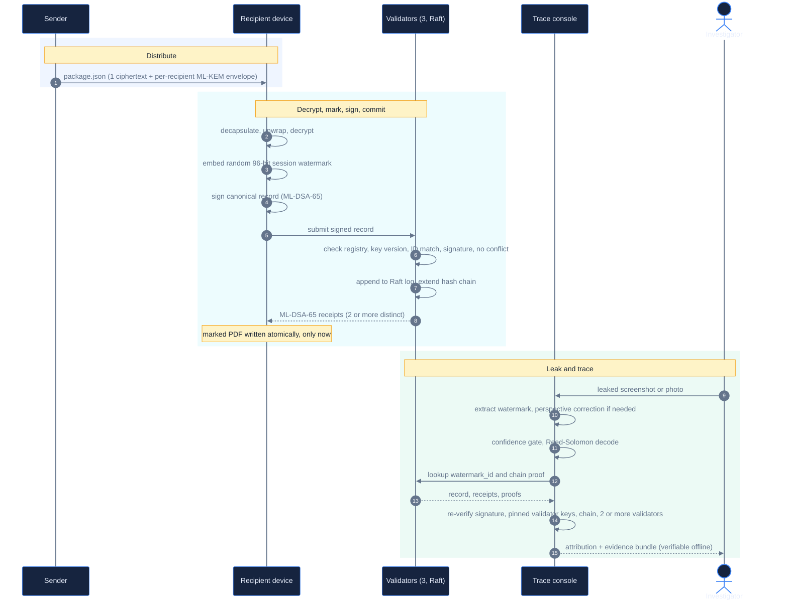

<div align="center">

# SIGILCHAIN

### A cryptographic chain of custody for decrypted documents

When a sensitive page leaks, prove which decryption session it came from, without trusting a server log.


[Overview](#overview) &middot; [Architecture](#architecture) &middot; [Measured results](#measured-results) &middot; [Quick start](#quick-start) &middot; [Threat model](#threat-model) &middot; [Configuration](#configuration) &middot; [Judge Q&A](CHEAT_SHEET.md)

</div>

---

## Contents

1. [Overview](#overview)
2. [Architecture](#architecture)
3. [Capabilities](#capabilities)
4. [Measured results](#measured-results)
5. [Quick start](#quick-start)
6. [Step-by-step internals](#step-by-step-internals)
7. [Threat model](#threat-model)
8. [Project structure](#project-structure)
9. [Tech stack](#tech-stack)
10. [Configuration](#configuration)
11. [Deployment modes](#deployment-modes)
12. [Comparison](#comparison)
13. [Roadmap](#roadmap)
14. [Team](#team)
15. [References](#references)

---

## Overview

A confidential PDF is sent to hundreds of people. Every one of them decrypts a **byte-identical** file. When one page appears on a forum, every recipient is an equally plausible source. Server logs can be edited by an administrator, a download is not a decryption, and a static watermark is the same for everyone.

SigilChain acts **at the moment of decryption**, not before it.

| Stage | What happens |
| --- | --- |
| Encrypt once | One AES-256-GCM ciphertext. Each recipient receives their own post-quantum ML-KEM-768 key envelope. |
| Mark at decrypt time | The recipient's local agent embeds a fresh, random, session-unique, invisible watermark into every page. |
| Sign the event | The agent signs a record of the decryption with the recipient's own ML-DSA-65 key. The private key stays on their device. |
| Commit before release | A three-member etcd/Raft log and signed validator receipts must reach two distinct receipts before the marked PDF is written to disk. No commit, no copy. |
| Trace and prove | A leaked screenshot or photo goes into the trace console. The watermark is recovered, and the signature, validator receipts and hash-chain proofs are re-verified on the client. The result is an evidence bundle that can be checked offline. |

> **Honest by design.** If the watermark is weak, the signature does not verify, or fewer than two pinned validators agree, SigilChain reports **inconclusive** and names no one. It never selects "the closest recipient".

### What a successful trace means

A recovered watermark ties a leaked copy to **one recorded, signed decryption session**. It does not, by itself, prove who physically distributed the copy. See the [threat model](#threat-model).

### Why existing approaches fall short

| Problem | SigilChain's answer |
| --- | --- |
| All recipients decrypt identical bytes | The watermark is generated per decryption session, not per document |
| Static watermarks are identical for every recipient | A random 96-bit ID is minted on the recipient's device at decrypt time |
| Access logs sit on infrastructure an administrator controls | A signed, replicated, hash-chained record that the investigator re-verifies independently |
| "Downloaded" is not "decrypted" | The signature is produced after decrypting and marking, over the hash of the exact marked PDF |
| A leak surfaces as a screenshot or a photo | Frequency-domain mark, error correction, and perspective correction for photographed pages |
| Sensitive networks have no cloud | No cloud KMS, no public chain, no runtime registry access. Ships as an offline Docker bundle on an egress-less network |
| Today's signatures may not survive tomorrow's computers | ML-KEM-768 and ML-DSA-65 throughout, including validator receipts |

---

## Architecture

<p align="center">
  
</p>

The four stages run left to right. The marked PDF only reaches the recipient's disk once the validator quorum has committed the signed record, and the investigator never has to trust a validator's own answer.

### Event lifecycle



### The signed record

```json
{
  "doc_id": "briefing-001",
  "recipient_id": "alice",
  "key_version": 1,
  "watermark_id": "<24 hex characters, 96 random bits>",
  "timestamp": 1760000000,
  "content_hash": "<sha256 of the exact watermarked PDF>"
}
```

The record is serialised with sorted keys and no whitespace, so verification is byte-exact on any machine. The page carries **only an opaque random ID**. Identity is resolved through the signed ledger record and is never written into the document.

### Components

| Component | Path | Responsibility |
| --- | --- | --- |
| Agent (CLI) | `agent/` | Sender encryption, recipient decryption, watermarking, signing, quorum submission, identity lifecycle |
| Cryptography | `crypto/` | Key generation and storage, hybrid encryption, record signing, document normalisation |
| Watermark engine | `watermark/` | DCT and DWT-DCT embedding and extraction, payload and Reed-Solomon coding, PDF page I/O, geometric correction |
| Validator node | `validator/` | FastAPI service: verifies events, writes the shared log, signs receipts, serves proofs |
| Trace console | `trace_console/` | Streamlit forensic UI and the offline evidence verifier |
| Configuration | `config.py` | Single, environment-overridable source of truth |

### Validator API

| Endpoint | Purpose |
| --- | --- |
| `POST /submit` | Submit a signed decryption record for verification and commit |
| `GET /verify/{watermark_id}` | Look up the record for a watermark ID |
| `GET /chain-proof/{watermark_id}` | Return the ordered hash-chain proof for a record |
| `GET /chain-integrity` | Check the integrity of the node's chain |
| `GET /node-info` | Report validator ID, ML-DSA-65 public key and fingerprint |
| `GET /identity/{recipient_id}` | Resolve a recipient's registered public keys |

Each validator checks that the recipient is registered and not revoked, that the key version is the active one, that `watermark_id` and `recipient_id` inside the signed bytes match the request, that the ML-DSA signature verifies, and that the `watermark_id` is not already committed to a different event.

---

## Capabilities

| Capability | Details |
| --- | --- |
| Post-quantum cryptography | ML-KEM-768 for key establishment, ML-DSA-65 for recipient and validator signatures, AES-256-GCM for content, HKDF-SHA256 for derivation, via `liboqs` |
| Session-bound invisible watermark | 8x8 block DCT coefficient-pair embedding, 96-bit ID plus 8 Reed-Solomon parity bytes, 40x spatial repetition, majority-vote extraction. Optional Haar DWT plus DCT mode |
| Photograph recovery (experimental) | Document-boundary detection, perspective warp, sub-pixel corner refinement, confidence-gated |
| Commit before release | The marked PDF is held in memory and written atomically (temporary file, `fsync`, rename) only after the quorum commits |
| Zero-trust trace console | Does not trust validator answers. Re-verifies the recipient signature, pins validator keys to a roster, checks chain proofs, and requires at least two distinct validators |
| Portable evidence bundle | One JSON file: leaked-page hash, recovered ID, confidence, signed record, recipient public identity, validator receipts, chain proofs. Verifiable with no network |
| Identity lifecycle | `enroll`, `rotate`, `revoke`, `protect-key`. Private identities are encrypted with scrypt and AES-GCM (12-character minimum passphrase). Old key versions are retained so historical evidence still verifies |
| Validator key pinning | Fingerprints are compared out of band, then pinned to a trust roster that the console and CLI reload live |
| Multi-format sender | PDF, Word and Writer documents, spreadsheets, presentations, text, Markdown, HTML, CSV and raster images are normalised to a canonical PDF through a strict allowlist |
| Air-gap deployment | Export and import scripts, an internal Docker network with no egress, and validator ports that are not published |
| API hardening | Optional shared API key on every validator endpoint, with a loud startup warning when it is unset |

---

## Measured results

Every figure below was reproduced from the scripts in [`tests/`](tests). They are **prototype measurements on synthetic inputs**, and the scope is stated next to each one on purpose.

| Experiment | Command | Result |
| --- | --- | --- |
| DCT watermark versus JPEG | `python -m tests.test_dct_watermark` | Payload recovered exactly (0.00% bit error) at lossless PNG and at JPEG quality 95, 90, 85, 75, 60, 50, 40, 30, 20 and 15 |
| Invisibility (DCT, default) | same | Mean absolute pixel change of about 0.5 out of 255 |
| Local damage | same | Exact recovery with the top 15%, bottom 15%, left 20% or a central 30% band blacked out (JPEG q=75) |
| DWT plus DCT mode | `python -m tests.test_dwt_dct_watermark` | Exact recovery at JPEG quality 95, 75, 50, 30, 20 and 15. Mean pixel change about 1.2 out of 255 |
| Photographed page | `python -m tests.test_part7_geometric` | Three synthetic perspective tilts (0.05, 0.12, 0.20) recovered exactly after correction. Without correction the bit error rate is roughly 47% to 51%, which is near random, so the geometry step is what makes recovery possible |
| Ledger tamper detection | `python tests/test_part5_ledger.py` | Edits a row directly in SQLite, bypassing the application, and asserts that the integrity check fails |
| Quorum and consensus | `tests/test_part5_quorum.py`, `tests/test_consensus.py` | Two distinct signed validator receipts required. Raft log ordering and conflict rejection |
| Format normalisation | `tests/test_document_normalization.py` | Allowlisted formats convert to a canonical PDF. Others are rejected |

> **Scope.** The watermark experiments use a synthetic text page, simulated JPEG re-encoding, and synthetic perspective warps. The Reed-Solomon layer provides additional headroom on top of these results, which come from the majority-vote layer alone. Real camera captures with glare, cropping or blur, and print-and-scan, have **not** been benchmarked. The console treats such inputs as inconclusive unless they fully verify.

---

## Quick start

**Requires:** Docker Desktop, or Docker Engine with Compose v2. Build images while online. Runtime needs no internet.

```bash
# 0. Recommended: enable API authentication for every service
export SIGILCHAIN_API_KEY="$(openssl rand -hex 32)"

# 1. Start 3x etcd, 3x validators and the trace console, plus the
#    loopback-only UI proxy
docker compose --profile local-ui up -d --build
#    Trace console: http://localhost:8501
```

```bash
# 2. Pin validator keys. Compare each fingerprint with an independently
#    trusted channel before typing PIN.
docker compose run --rm cli python scripts/bootstrap_validator_trust.py \
    --out /app/data/trust/validator_trust.json

# 3. Enroll recipients (prompts for a passphrase of at least 12 characters;
#    keys are generated on this machine)
docker compose run --rm cli python agent/cli.py enroll --as alice
docker compose run --rm cli python agent/cli.py enroll --as bob
```

```bash
# 4. SENDER: encrypt once for many recipients (place the file in ./cli-data/)
docker compose run --rm cli python agent/cli.py encrypt \
    --input /data/briefing.pdf --recipients alice,bob --out /data/package.json

# 5. RECIPIENT: decrypt, watermark, sign, commit, release
docker compose run --rm cli python agent/cli.py decrypt \
    --package /data/package.json --as alice --doc-id briefing-001 \
    --out-dir /data/decrypted
#    Output: ./cli-data/decrypted/briefing-001_alice.pdf
#    (written only if the validator quorum committed)
```

### Trace a leak

1. Screenshot a page of `briefing-001_alice.pdf`.
2. Open `http://localhost:8501` and upload the image or PDF.
3. Read the verdict:
   - **Verified:** recipient, document, session, extraction confidence, signature check, and receipts from at least two pinned validators.
   - **Inconclusive or not found:** no attribution is made, and the reason is shown.
4. Download the evidence bundle and verify it with no network:

```bash
python trace_console/verify_evidence.py ./sigilchain-evidence-<id>.json \
    --identity-db ./identity_registry.db \
    --validator-trust ./validator_trust.json
```

### Demonstrate tamper evidence

```bash
# Edits a ledger row directly in SQLite, bypassing the application,
# then runs the integrity check
python tests/test_part5_ledger.py
```

Stop one validator and decrypt again: a two-of-three quorum still commits. Stop two and **nothing is released**, which is the intended behaviour.

### Identity lifecycle

| Command | Effect |
| --- | --- |
| `enroll --as <id>` | Create a passphrase-protected identity and register its public keys |
| `rotate --as <id>` | Rotate keys while preserving prior public keys so older evidence still verifies |
| `revoke --as <id>` | Disable the active key in the registry |
| `protect-key --as <id>` | Encrypt an existing plaintext identity file in place |

---

## Step-by-step internals

<details>
<summary><b>1. Encrypt and distribute (sender)</b></summary>

1. The source file is converted to a canonical PDF by `crypto/normalize_document.py`, using a strict format allowlist.
2. A random 256-bit content key is generated, and the PDF is encrypted **once** with AES-256-GCM.
3. For each recipient: ML-KEM-768 encapsulation to their public key, HKDF-SHA256 (domain-separated), then an AES-GCM wrap of the content key.
4. The output is a single JSON package with one ciphertext and one small envelope per recipient. The cost of adding a recipient is one KEM operation.

</details>

<details>
<summary><b>2. Decrypt and mark (recipient device)</b></summary>

1. ML-KEM decapsulation with the recipient's own private key, then unwrap and decrypt.
2. Pages are rasterised to grayscale with PyMuPDF at 150 DPI.
3. `watermark_id = os.urandom(12)`: 96 bits, fresh for **every** decryption, even by the same person.
4. The ID is Reed-Solomon encoded (8 parity bytes). Each bit is embedded across 40 spread-out 8x8 blocks by ordering a mid-frequency DCT coefficient pair. Every page carries the full payload.
5. The PDF is reassembled. The mark lives in image data, so it survives screenshots and recompression within the limits measured above.

</details>

<details>
<summary><b>3. Sign and commit</b></summary>

1. The canonical record is signed with the recipient's ML-DSA-65 key. `content_hash` binds the signature to the exact marked bytes.
2. The record is sent to the validators, which run the checks listed under [Validator API](#validator-api).
3. Valid events are appended to a shared etcd/Raft ordered log. Each validator signs its own ML-DSA-65 receipt after observing the committed entry and extends its hash chain.
4. The agent waits for at least two distinct validator receipts before writing the PDF.

</details>

<details>
<summary><b>4. Trace and prove</b></summary>

1. Extract the watermark. If agreement is below the confidence threshold, attempt document-boundary detection and perspective correction, labelled experimental in the result.
2. If confidence is still below threshold after correction, stop and report inconclusive. Otherwise Reed-Solomon decode to recover the `watermark_id`.
3. Query all validators. Keep only answers whose receipt matches a **pinned** validator key and whose chain proof checks out.
4. Re-verify the recipient's ML-DSA signature in the console, against the identity registry, using the key version recorded in the event.
5. Require the same verified event from at least two distinct validators, then export the evidence bundle.

</details>

---

## Threat model

SigilChain gives investigators evidence about a recorded decryption session. It is explicit about what that evidence does and does not show.

| What the system supports | What it does not claim |
| --- | --- |
| A leaked copy carries the watermark of one specific signed decryption session | Proof of who physically leaked it. A stolen key or compromised device can sign events too |
| A record that an administrator cannot silently rewrite: changes break chain proofs and Raft quorum, and the verifier checks signatures itself | Protection from a compromised cluster administrator or a malicious majority. Raft tolerates crashes, not Byzantine behaviour |
| An investigator who does not have to trust a validator's own "valid" answer | A trusted clock. Timestamps are signed local-clock claims, and ordering comes from the Raft log |
| Safe failure: weak evidence yields inconclusive and no accusation | Guaranteed recovery from print-and-scan, heavy crops, or glare-heavy phone photographs |
| Quantum-resistant algorithm choices (ML-KEM-768, ML-DSA-65) | A production-certified cryptographic stack. `liboqs` is intended for prototyping, and this project has no FIPS validation |

### Known limitations

- The Docker Compose demo runs all three Raft members on one host, which is a single failure domain.
- The identity registry is a shared SQLite file: a demo-scale directory, not a production enrollment service.
- The marked output is currently a **flattened grayscale rasterisation**. Colour and vector content are not preserved.
- Recipient and document identifiers are not yet bound into the AES-GCM associated data, so envelope swapping between recipients is a known item to harden.
- Throughput has not been benchmarked beyond a handful of recipients.

### Mitigations in the prototype

Passphrase-encrypted private keys, key rotation and revocation with history retained, validator fingerprint pinning, an optional shared API key, recipient private keys that never leave the recipient's machine, and an internal Docker network with no egress.

---

## Project structure

```text
sigilchain/
|-- agent/                       recipient and sender CLI
|   |-- cli.py                   enroll, rotate, revoke, protect-key, encrypt, decrypt
|   `-- quorum_client.py         quorum submission, remote identity lookup
|-- crypto/                      post-quantum and symmetric cryptography
|   |-- keys.py                  ML-KEM/ML-DSA identities, registry, rotation, scrypt-protected keys
|   |-- encrypt.py, decrypt.py   one ciphertext, per-recipient ML-KEM envelopes
|   |-- sign.py                  canonical record, ML-DSA sign and verify
|   `-- normalize_document.py    multi-format to canonical PDF
|-- watermark/                   invisible watermark engine
|   |-- dct_watermark.py         DCT coefficient-pair embed and extract (default)
|   |-- dwt_dct_watermark.py     Haar DWT plus DCT (optional)
|   |-- payload.py               random ID and Reed-Solomon packing
|   |-- geometric_correction.py  perspective and sub-pixel refinement for photographs
|   `-- pdf_utils.py             PDF to and from page images
|-- validator/                   validator network
|   |-- node.py                  FastAPI: submit, verify, chain-proof, node-info, identity
|   |-- consensus.py             etcd/Raft ordered log
|   |-- ledger.py                hash-chained SQLite ledger and integrity checks
|   `-- attestation.py           ML-DSA-65 validator receipts
|-- trace_console/
|   |-- app.py                   Streamlit forensic console
|   `-- verify_evidence.py       offline evidence-bundle verifier
|-- docs/
|   `-- architecture.svg         architecture diagram used in this README
|-- scripts/                     trust bootstrap, air-gap export and import, launchers
|-- tests/                       watermark, geometry, ledger, quorum, consensus, keys, normalisation
|-- config.py                    environment-overridable configuration
|-- Dockerfile                   application and CLI images
|-- docker-compose.yml           3x etcd, 3x validators, console, cli, local-ui proxy
|-- requirements.txt
`-- CHEAT_SHEET.md               judge Q&A and scoped claims
```

---

## Tech stack

| Layer | Tools |
| --- | --- |
| Post-quantum cryptography | `liboqs` and `liboqs-python` (ML-KEM-768, ML-DSA-65); `cryptography` (AES-256-GCM, HKDF, scrypt) |
| Watermark | NumPy, SciPy (DCT), OpenCV (geometry), `reedsolo` (Reed-Solomon) |
| PDF and documents | PyMuPDF, Pillow, headless LibreOffice (sender-side only) |
| Ledger | etcd v3.6 (Raft), SQLite hash chains, FastAPI and Uvicorn, httpx |
| Console | Streamlit |
| Deployment | Docker Compose, multi-stage images, offline export and import bundle |

---

## Configuration

Every value can be overridden with an environment variable. Defaults reproduce the local demo setup. See [`config.py`](config.py) for the full list, including geometric-correction and recovery-confidence settings.

| Variable | Default | Meaning |
| --- | --- | --- |
| `SIGILCHAIN_NODE_URLS` | `http://127.0.0.1:8001,8002,8003` | Validator endpoints |
| `SIGILCHAIN_QUORUM_REQUIRED` | `2` | Distinct receipts needed to commit and release |
| `SIGILCHAIN_ETCD_ENDPOINTS` | unset | Shared Raft log (set by Compose). Unset means local SQLite, no consensus |
| `SIGILCHAIN_IDENTITY_DB` | `identity_registry.db` | Recipient public-key registry |
| `SIGILCHAIN_KEYS_DIR` | `local_keys` | Recipient identity files |
| `SIGILCHAIN_LEDGER_DB` | `node_ledger.db` | Per-validator ledger database |
| `SIGILCHAIN_VALIDATOR_TRUST_FILE` | `validator_trust.json` | Pinned validator public-key roster |
| `SIGILCHAIN_REQUIRE_TRUSTED_VALIDATORS` | `1` | Refuse receipts from validators that are not pinned |
| `SIGILCHAIN_WATERMARK_TRANSFORM` | `dct` | `dct` or `dwt-dct`. Must match between CLI and console |
| `SIGILCHAIN_EMBED_DELTA` | `110` (`dct`), `60` (`dwt-dct`) | Embedding strength |
| `SIGILCHAIN_EMBED_REPEAT` | `40` | Spatial repetition of the payload |
| `SIGILCHAIN_PDF_DPI` | `150` | Rasterisation resolution |
| `SIGILCHAIN_API_KEY` | unset (auth off, with warning) | Shared key for validator endpoints |

---

## Deployment modes

<details>
<summary><b>Docker Compose (recommended)</b></summary>

```bash
docker compose --profile local-ui up -d --build   # UI on http://localhost:8501 (loopback only)
```

The application network is `internal: true`: containers have no egress and validator ports are not published. The loopback-only proxy exposes just the console.

</details>

<details>
<summary><b>Air-gapped host</b></summary>

```powershell
# On an internet-connected machine: builds and exports the app, CLI and etcd images plus compose files
.\scripts\export_airgap_bundle.ps1

# Carry the folder across, then on the isolated Docker host:
.\import_airgap_bundle.ps1
docker compose --profile local-ui up -d
```

The bundle deliberately excludes private identity keys and persistent databases.

</details>

<details>
<summary><b>Local development (no Docker)</b></summary>

```bash
python -m venv venv && source venv/bin/activate     # Windows: venv\Scripts\activate
pip install -r requirements.txt                      # plus native liboqs
python verify_setup.py                               # confirms ML-KEM / ML-DSA and the PDF stack

# Three validators, each with its own ledger database
SIGILCHAIN_LEDGER_DB=node1.db uvicorn validator.node:app --port 8001 &
SIGILCHAIN_LEDGER_DB=node2.db uvicorn validator.node:app --port 8002 &
SIGILCHAIN_LEDGER_DB=node3.db uvicorn validator.node:app --port 8003 &
streamlit run trace_console/app.py
```

Without `SIGILCHAIN_ETCD_ENDPOINTS` there is **no distributed consensus**, only independent local chains. Use Compose to exercise the Raft path. Windows helper scripts (`scripts\start_nodes.bat`, `scripts\start_console.bat`, `scripts\demo_run.bat`) wrap the same steps.

</details>

---

## Comparison

| | Access logs | Static watermark | SigilChain |
| --- | :---: | :---: | :---: |
| Distinguishes recipients | No (a download is not a decryption) | No | Yes, per session |
| Survives a screenshot | Not applicable | Yes | Yes, within the measured scope |
| Tamper-evident record | No (administrator-editable) | Not applicable | Yes, replicated and hash-chained |
| Investigator verifies independently | No | No | Yes, offline evidence bundle |
| Works with no cloud | Yes | Yes | Yes |
| Post-quantum signatures | No | Not applicable | Yes |

Each ingredient (DCT watermarking, digital signatures, replicated logs) is established. The contribution here is the **integration**: a session-bound mark, a recipient-signed event, commit-before-release, and zero-trust verification, built to run fully offline.

---

## Roadmap

| Now | Next | Later |
| --- | --- | --- |
| Encrypt, decrypt-time watermark, signed record, Raft-ordered log, trace console, offline evidence verifier, Docker deployment | Bind identifiers into AEAD data, colour and vector preserving output, field-tested photograph recovery, benchmarks at 100 or more recipients, enrollment service in place of the shared registry | Validators on independent hosts under separate administrators, Byzantine fault tolerance, HSM or smart-card key custody, per-session key rotation |

---

## Team

| Name | Role |
| --- | --- |
| `[Member One]` | `[Role]` |
| `[Member Two]` | `[Role]` |

Contact: `[team-email@example.com]` &middot; `github.com/[your-repo]`

---

## References

- NIST FIPS 203, Module-Lattice-Based Key-Encapsulation Mechanism Standard (ML-KEM)
- NIST FIPS 204, Module-Lattice-Based Digital Signature Standard (ML-DSA)
- Open Quantum Safe project: `liboqs` and `liboqs-python`
- etcd, a distributed key-value store built on the Raft consensus algorithm

<div align="center">

**SigilChain** &mdash; built at HackInverse 2026 &middot; [hackinverse.tech](https://hackinverse.tech)

</div>